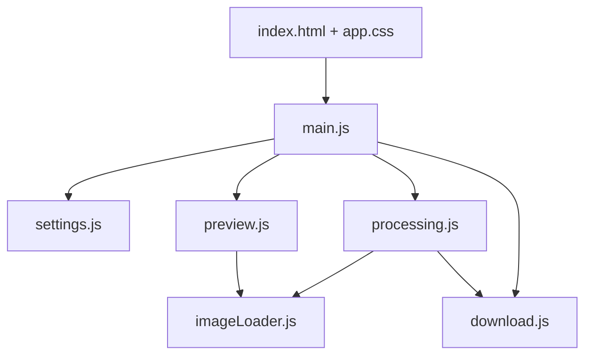

# Architecture

## Overview

ProPhoto is a client-side image pipeline: files stay on the user's machine; Canvas API performs resize and watermarking; JSZip packages exports.

## Build outputs

| Command | Output |
|---------|--------|
| `npm run dev` | Vite dev server at `:5173` |
| `npm run build` | Static bundle in `dist/` |
| `npm run dist:win` | Portable `.exe` in `dist-electron/` |
| `npm run release` | Copies exe + docs into `release/<version>/` and writes `SHA256.txt` |

## Electron

[`electron/main.cjs`](../electron/main.cjs) loads the Vite dev URL during development or `dist/index.html` in production.
